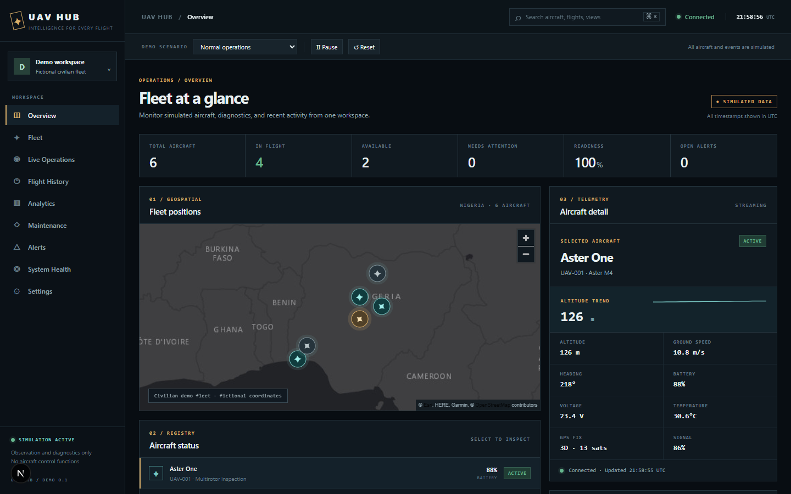

# Vektr

Vektr is a software-first portfolio demonstration of civilian unmanned aircraft fleet observation. Six fictional aircraft produce deterministic telemetry. The interface links a live map, aircraft health, alerts, stored flight replay, maintenance records, analytics, and a generic interactive 3D model. It does not control aircraft.

**Live demo:** [vektr.ng](https://vektr.ng). The Cloudflare Worker also serves `www.vektr.ng`.



[Mobile overview](docs/screenshots/overview-mobile.png) · [3D component explorer](docs/screenshots/aircraft-viewer.png)

## What works

- Overview and Live Operations: map markers, selected aircraft telemetry, connection state, and backend-derived fleet counts.
- Five simulator scenarios: normal, connectivity, battery, sensor, and maintenance. Pause, resume, and reset controls change the backend simulator.
- Server-sent telemetry events, persistent alert evidence with condition deduplication, and delayed or disconnected stream state.
- Fleet search, filtering, sorting, cards, aircraft records, and selectable 3D components.
- Six stored fictional flights, synchronized map and altitude replay, analytics from persisted records, and maintenance schedule.
- Local FastAPI administration: alert and maintenance updates guarded by a configured token, with audit events. The public Cloudflare demo disables administrative updates.

## Run locally

Requirements: Node.js 22+, Python 3.13+, and npm. PostgreSQL is supported; SQLite is the zero-setup local default.

```powershell
cd backend
py -3.13 -m venv ..\.venv
..\.venv\Scripts\python.exe -m pip install -r requirements.txt
..\.venv\Scripts\alembic.exe upgrade head
..\.venv\Scripts\python.exe -m uvicorn app.main:app --reload --host 127.0.0.1 --port 8000
```

In another terminal:

```powershell
cd frontend
npm ci
npm run dev
```

Open `http://localhost:3001`. The API defaults to `http://127.0.0.1:8000`; set `NEXT_PUBLIC_API_URL` in `frontend/.env.local` if needed. Set `ADMIN_TOKEN` in the API environment to enable record updates and enter it in Settings. Do not commit the token.

Alternatively run `docker compose up --build` from this directory to start PostgreSQL, the API, and the web app. The Compose password is only for local use.

## Demo walkthrough

1. Open Overview and select an aircraft on the map or list.
2. Choose **Connectivity degradation**; the first aircraft becomes delayed, then disconnected, and an evidence-backed alert appears.
3. Open Alerts to inspect the stored telemetry sample. Change to another scenario to see its specific condition.
4. Open Flight History, select a recorded session, then play or scrub the map and altitude together.
5. Open Fleet to inspect health fields and rotate/select components of the generic 3D model.
6. Open Maintenance and Analytics to inspect stored service records and calculated fleet measures.

## Check the build

```powershell
cd backend
..\.venv\Scripts\python.exe -m pytest -q
cd ..\frontend
npm run typecheck
npm run build
```

## Cloudflare deployment

The public version uses a static Next.js export and a Cloudflare Worker with a SQLite-backed Durable Object. The Worker serves the frontend and same-origin `/api/*` endpoints. Demo state, evidence-backed alerts, and recent telemetry survive Worker restarts; the six historical flight paths are regenerated deterministically from their fictional seed. Scenario controls affect the shared public demo; no administrative mutations are exposed.

```powershell
cd frontend
npm ci
$env:STATIC_EXPORT='1'
npm run build
cd ..\edge
npm ci
npm run check
npm run deploy
```

Cloudflare's `vektr` Worker serves the `vektr.ng/*` and `www.vektr.ng/*` routes. The domain is registered at OneBit and delegated to Cloudflare. The zone uses Cloudflare's Free plan. The API is served on the same origin, so no production `NEXT_PUBLIC_API_URL` is needed.

## Documentation

- [Architecture](docs/ARCHITECTURE.md)
- [API](docs/API.md)
- [Security](docs/SECURITY.md)
- [Design](docs/DESIGN.md)
- [Limitations](docs/LIMITATIONS.md)
- [Competitor research](docs/COMPETITOR_RESEARCH.md)

## Deployment

For a non-demo service with independent organizations or real integrations, the FastAPI backend needs a persistent Python process and managed PostgreSQL. Run `alembic upgrade head`, configure `DATABASE_URL` and `CORS_ORIGINS`, and replace the shared demo controls with per-user authorization. The Cloudflare deployment is a fictional public portfolio demonstration only.
