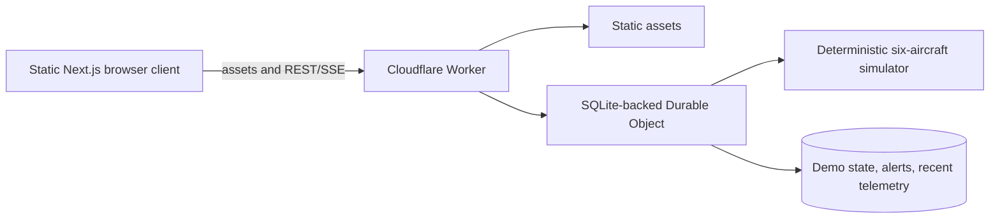
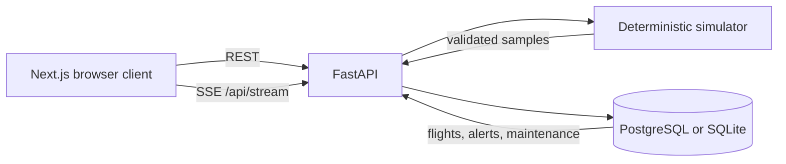

# Architecture

## Public Cloudflare demo

The Cloudflare Worker in `edge/` serves the static export and same-origin API. A single Durable Object serializes the shared public demo and persists its state. It emits telemetry over SSE while viewers are connected. Historic fictional flight paths are generated from deterministic seeds when requested. Administrative PATCH operations are disabled in the public version.

## Local FastAPI service

The Next.js frontend owns presentation and local selection state. `OperationsApp` coordinates navigation, scenarios, and search. `useFleet` loads an initial snapshot and applies SSE telemetry updates; if the connection becomes stale, it marks the link delayed or disconnected. MapLibre renders the map and recorded route; React Three Fiber renders a generic model on demand in Fleet.

The FastAPI process runs one deterministic simulator loop. Every second it validates six telemetry samples with Pydantic, persists them, evaluates alert conditions, deduplicates active conditions, and publishes an SSE event. Each subscriber has a bounded queue of one event so slow clients do not accumulate an unbounded backlog. `ready`, `telemetry`, `reset`, `state`, and `heartbeat` have distinct SSE event names.

SQLAlchemy models represent aircraft, telemetry samples, flights with recorded sample arrays, alerts with triggering evidence, maintenance records, and audit events. Alembic's initial migration creates the schema. On first run the store seeds six fictional aircraft, six maintenance records, and six 90-sample flights. SQLite permits easy local review; `DATABASE_URL` selects PostgreSQL for a hosted service. Live samples older than 24 hours are pruned every 300 simulator ticks. Recorded flights remain independent of live sample retention.

The selected aircraft ID is shared across Overview, Fleet, and Live Operations, so map and list selection update the same detail panel. Historical replay is separate from the live stream and advances through stored samples under one timeline.

The simulator's fault scenarios only alter synthetic observations. There is no command path to real aircraft, flight controller integration, mission planner, or location ingestion. See [Security](SECURITY.md) and [Limitations](LIMITATIONS.md) before considering any real-world integration.
